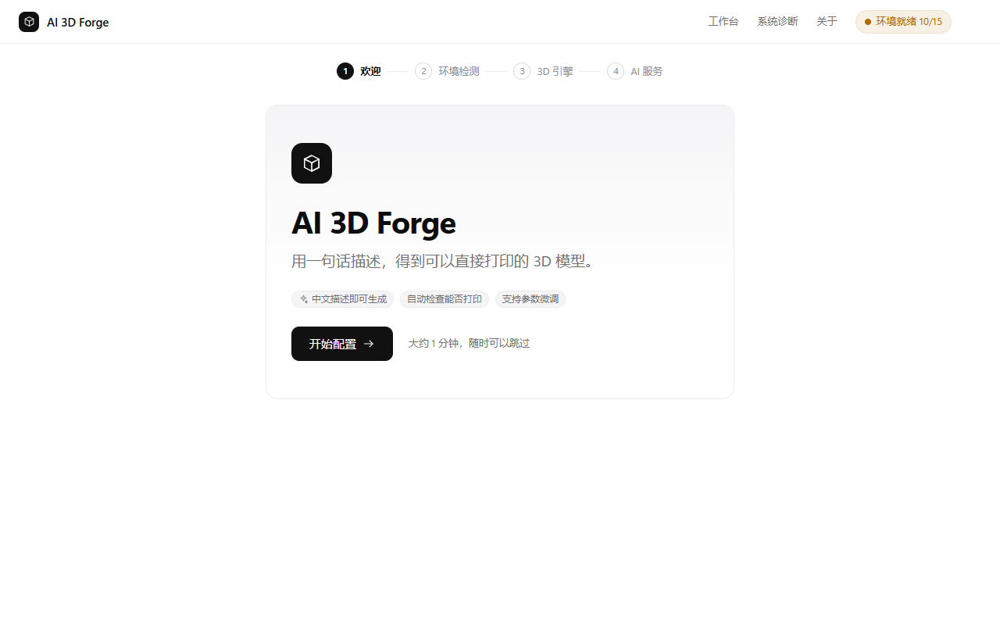
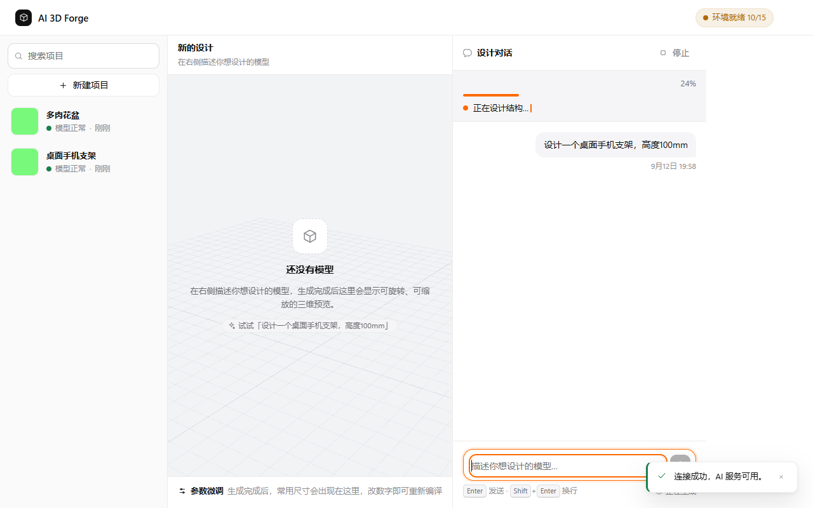
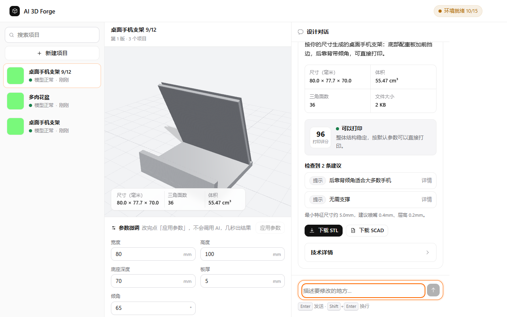

# AI 3D Forge

**Describe what you want in one sentence — get a 3D model you can actually print.**

[](https://github.com/xiiiii422/AI-3D-Forge/actions/workflows/ci.yml)
[](LICENSE)
[](#system-requirements)
[](https://www.python.org/)
[](CHANGELOG.md)

**English** | [简体中文](README.md)

A desktop tool for Windows that turns plain language into a printable model:
**natural language → parametric OpenSCAD → STL → slicer**.
No programming, no Python/Node.js install, no command line.



> Note: the application UI is currently Chinese-only. This README documents the
> project in English for GitHub visitors; the in-depth guides
> ([user guide](docs/USER_GUIDE.md), [development guide](docs/DEVELOPMENT.md))
> are Chinese for now. Contributions that localise the interface are welcome.

---

## Table of contents

- [What it is](#what-it-is)
- [Features](#features)
- [How it works](#how-it-works)
- [System requirements](#system-requirements)
- [Installation](#installation)
- [DeepSeek API setup](#deepseek-api-setup)
- [OpenSCAD setup (auto-install supported)](#openscad-setup-auto-install-supported)
- [Running it](#running-it)
- [3D printing capabilities](#3d-printing-capabilities)
- [Screenshots](#screenshots)
- [Your data and privacy](#your-data-and-privacy)
- [Tech stack](#tech-stack)
- [FAQ](#faq)
- [Contributing](#contributing)
- [License](#license)

---

## What it is

You type one sentence, for example:

> Design a desktop phone stand, 100 mm tall.

The app first turns that sentence into an **editable design spec** (dimensions,
required features, prohibitions) for you to confirm, then asks DeepSeek to write
**parametric OpenSCAD source**, compiles it with your local OpenSCAD into an **STL**,
previews it with Three.js, and measures the result for real — bounding box, wall
thickness, whether it is one connected solid, support volume, filament usage —
plus an AI printability review. Not happy? Just keep talking to it and download the
STL when it is right.

It is not a "picture of a 3D model" toy: the app measures, cross-checks, and
refuses to hand you something it can prove is unprintable.

## Features

| Feature | What it does |
|---|---|
| **One-sentence generation** | Chinese natural language → parametric SCAD → STL |
| **Requirement confirmation** | Turns your sentence into an editable spec card before generating; remembers what you said |
| **Real geometry measurement** | Parses the STL itself: bbox, volume, surface area, ray-cast wall thickness, connected parts, cavity intrusions, support volume, filament estimate |
| **Printability review** | Scores and explains the model **against your selected printer** (nozzle, build volume, material, overhang limit) |
| **Vision review** | Renders two views and has a multimodal model look at them, to catch what numbers cannot |
| **Natural-language edits** | “Make it 150 mm tall” — only the named parameter changes, and the app verifies exactly what moved |
| **Parameter tweaking** | Recompile in seconds by editing a number; no AI usage |
| **Build-volume safety net** | If it does not fit your printer, the AI redoes it, and if it still does not fit the app scales it down deterministically |
| **Dimensions in the preview** | Draws the three overall dimension lines (width / depth / height) with labels that track the camera; click any edge to see just that edge's length |
| **3MF and one-click send to slicer** | Same geometry as the STL but **declares millimetres** and carries printer/material metadata (no more “imported 10× too big”); when a local slicer is detected, one button opens it |
| **Version history** | Every project keeps revisions you can roll back to |
| **One-file delivery** | Installer with automatic 3D-engine setup; uninstall/upgrade never touches your projects |



## How it works

```
① You describe it in one sentence
        │
        ▼
② Requirement confirmation — the app turns it into a spec card (sizes / structure / prohibitions)
        │
        ▼
③ DeepSeek writes parametric OpenSCAD source (prompt includes your printer's constraints)
        │
        ▼
④ Source safety validation (blocks import/use/surface; geometry only)
        │
        ▼
⑤ OpenSCAD compiles it to STL
        │
        ▼
⑥ Programmatic measurement: size, wall thickness, connected parts, cavity intrusions, support
        │
        ▼
⑦ Two rendered views → vision review + printability review against your printer
        │
        ▼
⑧ Preview (with dimension callouts), iterate in plain language, tweak parameters,
   download 3MF/STL/SCAD — or send the model straight to your slicer
```

## System requirements

| Item | Requirement |
|---|---|
| OS | Windows 10 1809+ / Windows 11 (64-bit) |
| Disk | ~400 MB (app ~40 MB + OpenSCAD ~21 MB + your projects) |
| Network | Required while generating (calls your own DeepSeek API); previews and existing projects work offline |
| DeepSeek API key | Required ([platform.deepseek.com](https://platform.deepseek.com/api_keys), pay-per-use) |
| OpenSCAD | Required — the app can **install it for you** (official source + SHA-256 check) |
| From source (optional) | Python 3.10+, Node.js 18+ |

## Installation

### Option 1: installer (recommended)

1. Download `AI-3D-Forge-Setup.exe` from [Releases](../../releases)
2. Run it and click Next (it defaults to the D: drive to save space on C:)
3. It also installs OpenSCAD for you; then follow the in-app welcome wizard

### Option 2: from source

```powershell
git clone <repository-url> AI-3D-Forge
cd AI-3D-Forge

$env:PIP_CACHE_DIR    = "$(Get-Location)\build\cache\pip"
$env:npm_config_cache = "$(Get-Location)\build\cache\npm"

python -m venv build\venv
& build\venv\Scripts\python.exe -m pip install -r requirements-build.txt
cd webui; npm ci; npm run build; cd ..

& build\venv\Scripts\python.exe main.py
```

Full instructions (tests, packaging, CI) are in [docs/DEVELOPMENT.md](docs/DEVELOPMENT.md).

## DeepSeek API setup

1. Create an API key at [platform.deepseek.com/api_keys](https://platform.deepseek.com/api_keys)
2. Paste it into **Settings → AI service** (or the first-run wizard)
3. Click **Test connection**

The key is stored in the **Windows Credential Manager**, only ever shown masked
(`sk-1234****cdef`), and is masked in logs too. It is never written into source
code, the installer, or the repository. For scripts/CI you can set the
`DEEPSEEK_API_KEY` environment variable instead (lookup order: credential manager →
environment → local config file).

## OpenSCAD setup (auto-install supported)

The app does **not** bundle OpenSCAD (it is an independent GPLv2+ program). Instead it:

1. **Detects** existing installations (common paths, registry, `PATH`);
2. **Installs on request**: downloads from the official [openscad.org](https://openscad.org/)
   source, verifies the published **SHA-256**, installs without admin rights into the
   user profile, then runs a real CLI smoke test;
3. Or uses the copy you installed yourself — and if detection fails you can point it at
   `openscad.exe` manually in **Settings → 3D engine**.

Sources, versions and checksums are documented in
[docs/OPENSCAD-SOURCES.md](docs/OPENSCAD-SOURCES.md).

## Running it

Installed version: launch from the desktop shortcut. It opens its own window
(WebView2); if that runtime is missing it falls back to your browser with identical
functionality.

From source:

```powershell
& build\venv\Scripts\python.exe main.py            # desktop window
& build\venv\Scripts\python.exe main.py --browser  # system browser
& build\venv\Scripts\python.exe main.py --server   # local server only (127.0.0.1:8760)
& build\venv\Scripts\python.exe main.py --check    # print the environment report
```

The server binds to `127.0.0.1` only — other machines on your LAN cannot reach it.

## 3D printing capabilities

| Capability | What is actually done |
|---|---|
| Printer knowledge base | 13 built-in printers with real specs → executable constraints (min wall = 3 × nozzle, min hole, max overhang, bridge span); custom printers supported |
| Build-volume fitting | Measured against your build volume; AI redoes it if it does not fit, then deterministic scaling as a last resort — and it tells you the ratio |
| Wall thickness | Ray-cast measurement on the STL (min / 5th percentile / median), not a bounding-box guess |
| One-piece check | Connected-component analysis: is it one solid? If not, it reports how many loose parts, where, and how big |
| Cavity intrusions | Horizontal cross-sections detect material poking into a container's cavity (a classic misplaced-rib bug) |
| Support & filament | Estimates support volume from overhangs and gives a filament range (2 walls @15% infill … solid equivalent) plus filament length |
| Printability review | AI scores risk and suggests concrete fixes, based on the measurements above and your printer |



## Screenshots

All screenshots live in [`docs/images/`](docs/images/) (light theme, sample data from
the mock backend — no real accounts). **Settings → Appearance** adds a dark theme and an
optional *liquid glass* material (translucent panels, background blur, a highlight that
tracks the pointer, adjustable transparency). Popovers, menus and toasts deliberately
stay thick glass, so they never fade into unreadability along with the slider.

## Your data and privacy

- The local server listens on `127.0.0.1` only and validates the request origin;
- The API key lives in the Windows Credential Manager — never in source, logs or the installer;
- The only outbound requests are: your own DeepSeek API, and (after you confirm) the
  OpenSCAD download from openscad.org;
- Your models, projects and STLs are **never uploaded**; uninstalling or upgrading keeps your data;
- The repository contains no keys, tokens, cookies or machine-specific paths — enforced by
  `scripts/check_no_secrets.py` (including a Git-history scan) in CI.

## Tech stack

| Layer | Technology |
|---|---|
| UI | React 18 + TypeScript + Vite + hand-written CSS design system (no component library) |
| 3D preview | Three.js (renders STL directly via WebGL) |
| Backend | Python 3 + FastAPI + uvicorn (loopback only) |
| AI | DeepSeek (parametric SCAD generation / verification / printability; multimodal model for vision review) |
| 3D engine | OpenSCAD CLI |
| Window | WebView2 via pywebview, falling back to the system browser |
| Packaging | PyInstaller (onedir) + Inno Setup 6 |

Deliberate trade-offs: no numpy/trimesh (the STL parser uses the standard library),
no Electron/Tauri (reuse the system WebView2), no UI component library — which keeps
the release in the tens of megabytes.

## FAQ

**Do I need to know how to code?** No. It is a chat-style UI.

**Does it cost money?** The app is free (MIT). Generating calls your own DeepSeek API;
a typical design costs a fraction of a cent. Parameter tweaks cost nothing.

**Is the model guaranteed printable?** The app measures size, wall thickness,
one-piece-ness and support, and reports a verdict — but always sanity-check
strength and safety yourself, especially for load-bearing parts.

**Can I install it outside C:?** Yes; the installer prefers D: by default.

**Does uninstalling delete my models?** No — program and data are stored separately.

More in the user guide (Chinese): [docs/USER_GUIDE.md](docs/USER_GUIDE.md).

## Contributing

Issues and pull requests are welcome:

- Workflow, code style and acceptance criteria: [CONTRIBUTING.md](CONTRIBUTING.md)
- Development setup, tests and builds: [docs/DEVELOPMENT.md](docs/DEVELOPMENT.md)
- Security issues: report privately per [SECURITY.md](SECURITY.md) — please do **not** open a public issue
- Release notes: [CHANGELOG.md](CHANGELOG.md)

## License

This project is released under the **MIT License** — see [LICENSE](LICENSE).

- Third-party components and their licenses: [docs/LICENSE-THIRD-PARTY.txt](docs/LICENSE-THIRD-PARTY.txt)
- **OpenSCAD is not bundled**: it is an independent open-source program (GPLv2+)
  downloaded from the [official site](https://openscad.org/) and verified before use;
  its license text is in [docs/LICENSE-OpenSCAD-GPLv2.txt](docs/LICENSE-OpenSCAD-GPLv2.txt)
